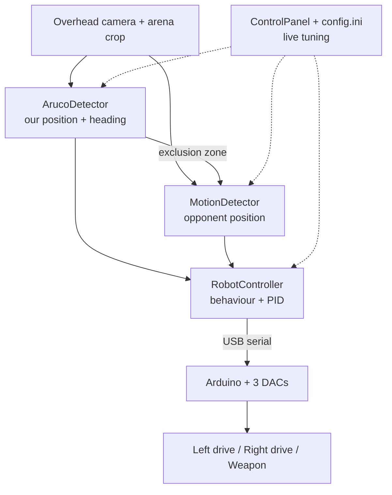
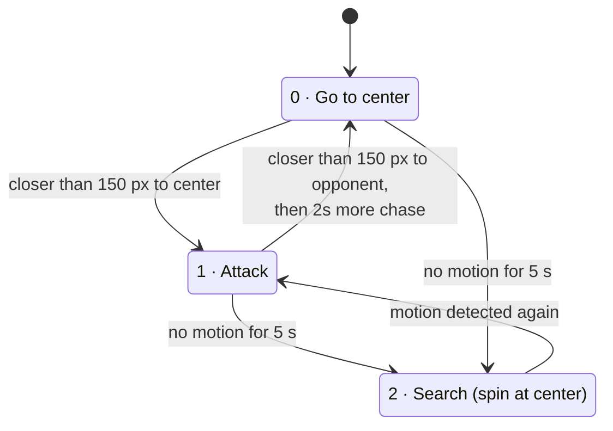

# CakeAI-V1 Architecture

**English** | [Русский](ARCHITECTURE_RU.md)

This document explains how CakeAI-V1 works inside: what each part does, how data flows from the camera to the motors, and why some design decisions were made. For build instructions, see [README.md](README.md).

## Overview

CakeAI is a beetleweight combat robot with no human driver. A camera mounted above the arena watches the whole fight. A program on a laptop finds our robot and the opponent in every frame, decides where to drive, and sends commands to an Arduino, which turns them into analog control signals for the robot.

## Components

| File | Responsibility |
| --- | --- |
| `src/main.cpp` | Program entry: opens the camera and serial port, wires up the control panel, runs the main loop |
| `src/ArucoDetector.cpp` | Finds the ArUco marker on our robot, returns its center and rotation |
| `src/MotionDetector.cpp` | Finds the opponent by frame-to-frame motion, ignoring the area around our robot |
| `src/RobotController.cpp` | Behaviour state machine, stuck detection, PID steering, channel mixing |
| `include/PIDController.h` | Generic PID controller (supports output limits and anti-windup; limits are not used in this project) |
| `include/ArduinoController.h` | Opens the serial port and sends text commands (Windows and Linux/macOS) |
| `src/ControlPanel.cpp` | Win32 window with buttons and fields for live tuning |
| `src/ConfigManager.cpp` | Loads and saves all tunable values to `config.ini` |
| `src/ArduinoProgram.ino` | Arduino firmware: parses commands and sets DAC outputs |

## The main loop

Everything that touches the camera runs in one thread, once per frame:

1. **Capture** a frame (DirectShow, requested 1280×1024 at 150 FPS).
2. **Crop** to the arena rectangle. Everything outside the arena (people, walls, lights) is thrown away, so it can't be mistaken for movement.
3. **Detect our robot** with ArUco.
4. **Build the exclusion zone** around our robot.
5. **Detect the opponent** with motion detection, excluding that zone.
6. **Decide and drive**: `RobotController::process()` computes three channel values and sends them to the Arduino.
7. **Draw the overlay** (marker, exclusion zone, target, PID values, FPS) and show it.

The control panel runs in a second thread. Values it changes are picked up on the next frame without stopping the robot. Most of them are `std::atomic`; the PID gains, KRL and KFB are plain variables.

### Setup before a fight

- **Arena crop:** two mouse clicks on the video select the arena rectangle.
- **Arena center:** a mouse click sets the point the robot returns to. Its coordinates are converted to the cropped frame.
- **Exposure** is set in the control panel and applied with **Apply** (the value saved in `config.ini` is not applied at startup).
- **Robot check** button: drives forward (70/70) and backward (30/30) for 0.5 s each, then ramps the weapon 0 → 40% → 0, to make sure everything is connected.
- **Test mode** (panel switch or the **T** key): a mouse click sets a fake opponent point, so the behaviour can be tested without a second robot.

All values are saved to `config.ini` automatically when the program closes.

## Perception

### Our robot: ArUco marker

- Dictionary `DICT_4X4_50`. Only IDs **0** and **1** are accepted, everything else is ignored. If several markers are found, the first one is used.
- ID 0 is on the top, ID 1 on the bottom. If the camera sees ID 1, the robot is upside down and the drive channels are swapped and inverted, so that it keeps driving in the intended direction (this depends on how the bottom marker is mounted). Spinning in place is not inverted, so an upside-down robot spins the other way.
- Heading is computed from the marker's top edge (`atan2` of the top-left → top-right corners). The robot's "forward" is the direction of that edge, so the marker has to be mounted with this edge pointing forward.
- Detection uses a fast parameter set without corner refinement (the code comment calls it "fast mode").
- **Persistence:** if the marker disappears (motion blur, a hit, lighting), the last known position and heading are used for up to 3 seconds. During that time the robot keeps driving on this old data, and the upside-down correction is not applied because the marker ID is unknown.

### Opponent: motion detection

The opponent has no marker, so the program looks for anything that moves:

1. Grayscale + Gaussian blur to remove noise.
2. Absolute difference with the previous frame.
3. Threshold, then dilate and erode to join the pieces into solid blobs.
4. Erase the **exclusion zone**: a circle around our robot, shifted a few pixels forward along its heading. Without it, our own movement would be the biggest moving thing in the frame, and the robot would chase itself.
5. Keep only blobs at least 20×20 px, and take the center of all remaining moving pixels as the opponent position.

If motion disappears (the opponent stopped), the last point is kept for up to 5 seconds.

All parameters (threshold, kernel sizes, blur, exclusion radius and offset) are editable in the control panel, because they depend heavily on the arena and the lighting.

## Behaviour

`RobotController` uses three states:

- **State 0, go to center.** This is also the start state, so after START the robot first drives to the center. When the robot gets close to the opponent, it counts this as an attack and goes back to the arena center instead of staying stuck to the opponent. For the first 2 seconds after the switch it still drives at the opponent, then the target changes to the center.
- **State 1, attack.** Drive at the opponent.
- **State 2, search.** No opponent visible: drive to the center and spin in place there.

The distances (150 px) and the timeout (2000 ms) are tunable. The transitions between states 0 and 1 only work when `CenterAfterAttack = 1`, and they are not checked on frames where the robot is spinning in place.

**Reverse driving** (when `UseReverse = 1`). When returning to the center after at least one attack, the robot drives backwards if the center is more than 90° (`ReverseAngleThreshold / 2`) away from its heading, instead of turning all the way around. When the center is in front of it, it drives forward again.

### Spinning in place

The normal driving logic is overridden, and the robot spins in place, when:

- the marker has been lost for more than 3 seconds (our own position is unknown). In this case the exclusion zone also disappears, so motion detection can pick up our own robot;
- the robot is **stuck** (see below);
- the robot is in the search state and already near the center.

Spin speed is set by `InPlaceSpeedRotation` (0.5 gives drive channels 25 and 75), and weapon speed by `InPlaceSpeedWeapon`. In normal driving the weapon always runs at 100%.

### Stuck detection

Once a second, the robot's position and rotation are recorded (a short history of 30 records). The current record is compared with the one from 3 seconds earlier. If the robot moved less than 30 px and turned less than 10°, it is considered stuck, for example pinned against a wall. Then it spins in place, and the weapon speed slowly oscillates between 100% and 50% of `InPlaceSpeedWeapon` over a 4-second cycle to help it break free.

## Control

### Steering

1. The angle to the target (center or opponent) is computed with `atan2`.
2. The **heading error** is the difference between that angle and the robot's heading, normalized to −180°…180°.
3. The PID controller turns the error into a turn command, scaled by **KRL**.
4. Differential drive mixing: `left = 50 − turn`, `right = 50 + turn` (50 is neutral).

### Forward speed

Forward speed is added on top of the turn command and depends on how well the robot is aimed:

- error ≤ `AngleMaxExtraSpeed` → full speed;
- error ≥ `AngleMinExtraSpeed` → no forward speed, only turning;
- in between → linear interpolation;
- the result is scaled by **KFB** (so with KFB = 0.4, "full speed" adds +40).

The final channel values are clamped to 0–100.

So the robot turns on the spot when the target is far to the side or behind, and accelerates as it lines up.

### Weapon

Channel 3 is the weapon. On START, it ramps up from 0 to 100% over 3 seconds instead of jumping to full power.

### Tuned values (Crashilovo, April 2026)

| Parameter | Value | Meaning |
| --- | --- | --- |
| Kp / Ki / Kd | 0.25 / 0.0 / 0.05 | integral term is off |
| KRL | 1.55 | turn command multiplier |
| KFB | 0.4 | forward speed multiplier |
| AngleMinExtraSpeed / AngleMaxExtraSpeed | 90° / 0° | forward speed fades out from 0° to 90° error |
| CenterAfterAttack / UseReverse / ReverseAngleThreshold | 1 / 1 / 180° | return to center after attacks, drive backwards when the center is more than 90° off |
| CenterTriggerThreshold / EnemyTriggerThreshold | 150 px / 150 px | "reached center" / "reached opponent" |
| EnemyTriggerTimeout | 2000 ms | keep chasing after an attack before going to center |
| InPlaceSpeedRotation / InPlaceSpeedWeapon | 0.5 / 1.0 | spin speed / weapon speed while spinning |
| Exclusion radius / offset | 120 px / 10 px | area around our robot ignored by motion detection |
| MotionThreshold / BlurSigma | 25 / 3 | motion detection sensitivity and smoothing |

## Hardware link

### Serial protocol

The PC sends one text line per command at 115200 baud:

| Command | Meaning |
| --- | --- |
| `1:P:75` | channel 1 to 75% |
| `3:Y:512` | channel 3 to input value 512 (0–1023, mapped to the DAC range by the firmware) |
| `A:P:50` | all channels to 50% |

Channels: **1** = left drive, **2** = right drive, **3** = weapon. For drive channels 50% is neutral, below 50 is reverse, above 50 is forward.

Each frame sends three separate lines, one per channel, without any delays: the latest values simply overwrite the previous ones. The firmware replies `OK ...` to every command, but the PC doesn't read the replies.

### Firmware

The Arduino controls three **MCP4725** DACs. All of them have the same I2C address, so they are connected through a **TCA9548A** I2C multiplexer (mux channels 5, 6, 7), which selects one DAC at a time.

- Percent values (`P`) are mapped linearly to the DAC range 170–4000.
- Input values (`Y`, 0–1023) use a two-part mapping: 0 → 170, 1–49 → 170–300, 50–1023 → 300–4000.

Each DAC output is an analog control voltage for one channel.

## Safety

- **STOP** in the control panel sets all channels to neutral (drives 50%, weapon 0%).
- **Exit:** when the program closes (ESC or window close), drives go to 50% and the weapon to 0%.
- **Startup speed test:** right after the serial port opens, the program sends about 1300 command lines to measure serial speed (channel 1 gets 50–59, channel 2 gets 41–50). The last values (59 / 41) stay active during the following 3-second pause, so the robot slowly spins for about 3 seconds before neutral is sent. It should be held or on a stand at launch.
- **Robot check** runs in a separate thread. Pressing it during a fight mixes its commands with the main loop's commands.

## Known limitations

- **Windows only.** The control panel uses the Win32 API, and the camera uses DirectShow. The serial code has a Linux/macOS code path, but it is untested (it passes `115200` directly instead of `B115200` to `cfsetospeed`).
- **The serial port is hard-coded** as `COM3` in `main.cpp`.
- **No watchdog in the firmware.** If the laptop freezes or the USB cable disconnects, the Arduino keeps outputting the last values. At power-on all DACs start at the minimum (170), which corresponds to 0%. On drive channels 0% means full reverse, not neutral, until the PC sends the first command.
- **One opponent.** All moving pixels are averaged into one point, so it doesn't work with several moving objects.
- **Pixels, not real units.** Distances and thresholds are in pixels and depend on the camera height and resolution, so they have to be retuned for every arena.

---

This document describes V1, the version that competed at Crashilovo on April 25, 2026. The current version of CakeAI is not public.
