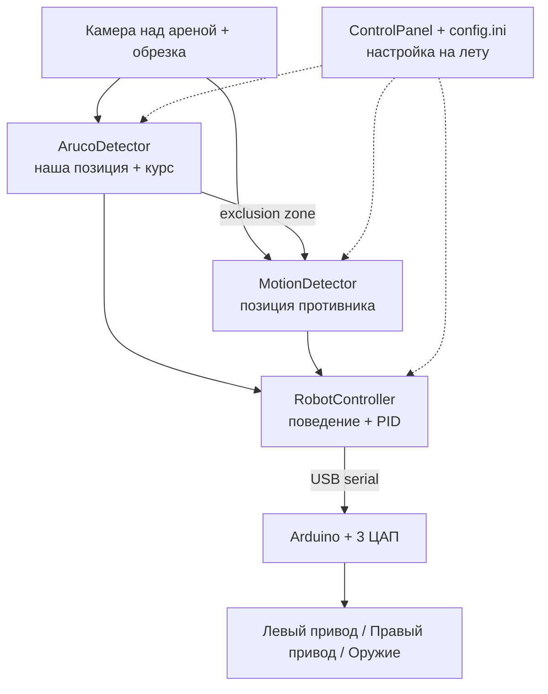
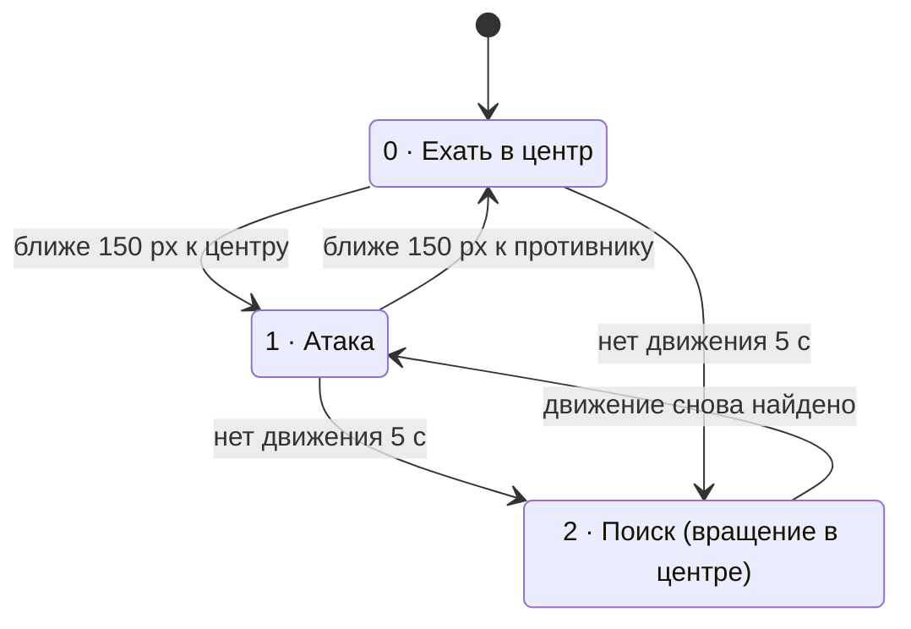

# Архитектура CakeAI-V1

[English](ARCHITECTURE.md) | **Русский**

Этот документ объясняет, как CakeAI-V1 устроен внутри: что делает каждая часть, как данные проходят путь от камеры до моторов и почему некоторые решения сделаны именно так. Инструкции по сборке — в [README_RU.md](README_RU.md).

## Обзор

CakeAI — автономный боевой робот весовой категории beetleweight без человека за пультом. Камера над ареной видит весь бой. Программа на ноутбуке в каждом кадре находит нашего робота и противника, решает, куда ехать, и отправляет команды на Arduino, которая превращает их в аналоговые управляющие сигналы для робота.

## Компоненты

| Файл | Что делает |
| --- | --- |
| `src/main.cpp` | Точка входа: открывает камеру и последовательный порт, подключает панель управления, запускает главный цикл |
| `src/ArucoDetector.cpp` | Находит ArUco-маркер на нашем роботе, возвращает его центр и поворот |
| `src/MotionDetector.cpp` | Находит противника по движению между кадрами, игнорируя область вокруг нашего робота |
| `src/RobotController.cpp` | Машина состояний поведения, определение застревания, PID-рулёжка, смешивание каналов |
| `include/PIDController.h` | Универсальный PID-регулятор (поддерживает ограничения выхода и anti-windup; в этом проекте ограничения не используются) |
| `include/ArduinoController.h` | Открывает последовательный порт и отправляет текстовые команды (Windows и Linux/macOS) |
| `src/ControlPanel.cpp` | Окно Win32 с кнопками и полями для настройки на лету |
| `src/ConfigManager.cpp` | Загружает и сохраняет все настраиваемые значения в `config.ini` |
| `src/ArduinoProgram.ino` | Прошивка Arduino: разбирает команды и выставляет выходы ЦАП |

## Главный цикл

Всё, что связано с камерой, работает в одном потоке, один раз за кадр:

1. **Захват** кадра (DirectShow, запрашивается 1280×1024 при 150 FPS).
2. **Обрезка** до прямоугольника арены. Всё за её пределами (люди, стены, свет) отбрасывается, чтобы не принять это за движение.
3. **Поиск нашего робота** по ArUco.
4. **Построение exclusion zone** (зоны исключения) вокруг нашего робота.
5. **Поиск противника** детекцией движения, без этой зоны.
6. **Решение и управление**: `RobotController::process()` вычисляет значения трёх каналов и отправляет их на Arduino.
7. **Отрисовка оверлея** (маркер, exclusion zone, цель, значения PID, FPS) и вывод на экран.

Панель управления работает во втором потоке. Изменённые в ней значения подхватываются на следующем кадре, без остановки робота. Большинство из них — `std::atomic`; коэффициенты PID, KRL и KFB — обычные переменные.

### Подготовка перед боем

- **Обрезка арены:** два клика мышью по видео задают прямоугольник арены.
- **Центр арены:** клик мышью задаёт точку, в которую робот возвращается. Её координаты пересчитываются в систему обрезанного кадра.
- **Экспозиция** задаётся в панели управления и применяется кнопкой **Apply** (значение из `config.ini` при запуске не применяется).
- **Кнопка Robot check:** едет вперёд (70/70) и назад (30/30) по 0,5 с, затем плавно разгоняет оружие 0 → 40% → 0, чтобы проверить, что всё подключено.
- **Тестовый режим** (переключатель на панели или клавиша **T**): клик мышью задаёт фиктивную точку противника, так что поведение можно проверить без второго робота.

Все значения автоматически сохраняются в `config.ini` при закрытии программы.

## Восприятие

### Наш робот: ArUco-маркер

- Словарь `DICT_4X4_50`. Принимаются только ID **0** и **1**, остальные игнорируются. Если найдено несколько маркеров, используется первый.
- ID 0 — сверху, ID 1 — снизу. Если камера видит ID 1, робот перевёрнут: каналы приводов меняются местами и инвертируются, чтобы он продолжал ехать в нужную сторону (это зависит от того, как закреплён нижний маркер). Вращение на месте не инвертируется, поэтому перевёрнутый робот крутится в другую сторону.
- Курс вычисляется по верхней грани маркера (`atan2` от верхнего левого к верхнему правому углу). «Перёд» робота — направление этой грани, поэтому маркер нужно крепить этой гранью вперёд.
- Детекция использует быстрый набор параметров без уточнения углов (в комментарии к коду — «fast mode»).
- **Удержание:** если маркер пропал (смазывание, удар, свет), последние известные позиция и курс используются до 3 секунд. Всё это время робот едет по старым данным, а коррекция для перевёрнутого положения не применяется, потому что ID маркера неизвестен.

### Противник: детекция движения

У противника нет маркера, поэтому программа ищет всё, что движется:

1. Оттенки серого + размытие по Гауссу, чтобы убрать шум.
2. Абсолютная разница с предыдущим кадром.
3. Порог, затем dilate и erode, чтобы склеить куски в сплошные пятна.
4. Стирание **exclusion zone**: круга вокруг нашего робота, сдвинутого на несколько пикселей вперёд по курсу. Без неё наше собственное движение было бы самым большим движущимся объектом в кадре, и робот гонялся бы сам за собой.
5. Остаются только пятна размером не меньше 20×20 px, а центр всех оставшихся движущихся пикселей считается позицией противника.

Если движение пропало (противник остановился), последняя точка держится до 5 секунд.

Все параметры (порог, размеры ядер, размытие, радиус и смещение exclusion zone) настраиваются в панели управления, потому что сильно зависят от арены и освещения.

## Поведение

`RobotController` использует три состояния:

- **Состояние 0, ехать в центр.** Это и стартовое состояние, поэтому после START робот сначала едет в центр. Когда робот подъезжает близко к противнику, это считается атакой, и он возвращается в центр арены, а не остаётся прижатым к противнику. Первые 2 секунды после переключения он ещё едет на противника, затем цель меняется на центр.
- **Состояние 1, атака.** Ехать на противника.
- **Состояние 2, поиск.** Противника не видно: ехать в центр и крутиться там на месте.

Расстояния (150 px) и таймаут (2000 мс) настраиваются. Переходы между состояниями 0 и 1 работают только при `CenterAfterAttack = 1` и не проверяются в кадрах, где робот вращается на месте.

**Езда задом** (при `UseReverse = 1`). Возвращаясь в центр хотя бы после одной атаки, робот едет задом, если центр отклонён от его курса больше чем на 90° (`ReverseAngleThreshold / 2`), вместо того чтобы разворачиваться целиком. Когда центр оказывается впереди, он снова едет вперёд.

### Вращение на месте

Обычная логика езды отключается, и робот крутится на месте, когда:

- маркер потерян больше 3 секунд (наша позиция неизвестна). В этом случае пропадает и exclusion zone, поэтому детекция движения может захватить нашего собственного робота;
- робот **застрял** (см. ниже);
- робот в состоянии поиска и уже рядом с центром.

Скорость вращения задаёт `InPlaceSpeedRotation` (0.5 даёт каналы приводов 25 и 75), скорость оружия — `InPlaceSpeedWeapon`. При обычной езде оружие всегда работает на 100%.

### Определение застревания

Раз в секунду записываются позиция и поворот робота (короткая история из 30 записей). Текущая запись сравнивается с записью трёхсекундной давности. Если робот сдвинулся меньше чем на 30 px и повернулся меньше чем на 10°, он считается застрявшим — например, прижатым к стене. Тогда он крутится на месте, а скорость оружия плавно колеблется между 100% и 50% от `InPlaceSpeedWeapon` с циклом 4 секунды, чтобы помочь ему вырваться.

## Управление

### Рулёжка

1. Угол на цель (центр или противника) вычисляется через `atan2`.
2. **Ошибка курса** — разница между этим углом и курсом робота, приведённая к −180°…180°.
3. PID-регулятор превращает ошибку в команду поворота, умноженную на **KRL**.
4. Смешивание для дифференциального привода: `left = 50 − turn`, `right = 50 + turn` (50 — нейтраль).

### Скорость вперёд

Скорость вперёд добавляется поверх команды поворота и зависит от того, насколько точно робот нацелен:

- ошибка ≤ `AngleMaxExtraSpeed` → полная скорость;
- ошибка ≥ `AngleMinExtraSpeed` → без скорости вперёд, только поворот;
- между ними → линейная интерполяция;
- результат умножается на **KFB** (при KFB = 0.4 «полная скорость» добавляет +40).

Итоговые значения каналов ограничиваются диапазоном 0–100.

Поэтому робот разворачивается на месте, когда цель далеко сбоку или сзади, и разгоняется по мере того, как нацеливается.

### Оружие

Канал 3 — оружие. По START оно плавно разгоняется от 0 до 100% за 3 секунды, а не включается сразу на полную мощность.

### Настройки (Крашилово, апрель 2026)

| Параметр | Значение | Смысл |
| --- | --- | --- |
| Kp / Ki / Kd | 0.25 / 0.0 / 0.05 | интегральная составляющая выключена |
| KRL | 1.55 | множитель команды поворота |
| KFB | 0.4 | множитель скорости вперёд |
| AngleMinExtraSpeed / AngleMaxExtraSpeed | 90° / 0° | скорость вперёд падает от 0° до 90° ошибки |
| CenterAfterAttack / UseReverse / ReverseAngleThreshold | 1 / 1 / 180° | возврат в центр после атак, езда задом, если центр отклонён больше чем на 90° |
| CenterTriggerThreshold / EnemyTriggerThreshold | 150 px / 150 px | «доехал до центра» / «доехал до противника» |
| EnemyTriggerTimeout | 2000 мс | сколько ещё преследовать после атаки, прежде чем ехать в центр |
| InPlaceSpeedRotation / InPlaceSpeedWeapon | 0.5 / 1.0 | скорость вращения / скорость оружия при вращении |
| Радиус / смещение exclusion zone | 120 px / 10 px | область вокруг нашего робота, которую игнорирует детекция движения |
| MotionThreshold / BlurSigma | 25 / 3 | чувствительность и сглаживание детекции движения |

## Связь с железом

### Протокол последовательного порта

ПК отправляет одну текстовую строку на команду на скорости 115200 бод:

| Команда | Смысл |
| --- | --- |
| `1:P:75` | канал 1 на 75% |
| `3:Y:512` | канал 3 на входное значение 512 (0–1023, прошивка переводит его в диапазон ЦАП) |
| `A:P:50` | все каналы на 50% |

Каналы: **1** — левый привод, **2** — правый привод, **3** — оружие. Для приводов 50% — нейтраль, меньше 50 — назад, больше 50 — вперёд.

Каждый кадр отправляются три отдельные строки, по одной на канал, без задержек: новые значения просто перезаписывают старые. Прошивка отвечает `OK ...` на каждую команду, но ПК ответы не читает.

### Прошивка

Arduino управляет тремя ЦАП **MCP4725**. У всех одинаковый I2C-адрес, поэтому они подключены через I2C-мультиплексор **TCA9548A** (каналы 5, 6, 7), который выбирает по одному ЦАП за раз.

- Проценты (`P`) линейно переводятся в диапазон ЦАП 170–4000.
- Входные значения (`Y`, 0–1023) переводятся в две ступени: 0 → 170, 1–49 → 170–300, 50–1023 → 300–4000.

Выход каждого ЦАП — аналоговое управляющее напряжение для одного канала.

## Безопасность

- **STOP** в панели управления ставит все каналы в нейтраль (приводы 50%, оружие 0%).
- **Выход:** при закрытии программы (ESC или закрытие окна) приводы встают на 50%, оружие — на 0%.
- **Тест скорости при запуске:** сразу после открытия порта программа отправляет около 1300 командных строк, чтобы измерить скорость связи (канал 1 получает 50–59, канал 2 — 41–50). Последние значения (59 / 41) остаются активными во время следующей паузы в 3 секунды, поэтому робот около 3 секунд медленно крутится, прежде чем уходит нейтраль. При запуске его нужно держать в руках или поставить на подставку.
- **Robot check** работает в отдельном потоке. Если нажать его во время боя, его команды перемешаются с командами главного цикла.

## Известные ограничения

- **Только Windows.** Панель управления использует Win32 API, а камера — DirectShow. В коде порта есть ветка для Linux/macOS, но она не проверена (в `cfsetospeed` передаётся `115200` напрямую вместо `B115200`).
- **Порт жёстко прописан** как `COM3` в `main.cpp`.
- **В прошивке нет watchdog.** Если ноутбук зависнет или отключится USB-кабель, Arduino продолжит выдавать последние значения. При включении питания все ЦАП стартуют с минимума (170), что соответствует 0%. Для приводов 0% — это полный назад, а не нейтраль, пока ПК не пришлёт первую команду.
- **Один противник.** Все движущиеся пиксели усредняются в одну точку, поэтому с несколькими движущимися объектами это не работает.
- **Пиксели, а не реальные единицы.** Расстояния и пороги заданы в пикселях и зависят от высоты камеры и разрешения, поэтому их нужно перенастраивать под каждую арену.

---

Этот документ описывает V1 — версию, которая выступала на Крашилово 25 апреля 2026 года. Текущая версия CakeAI не публичная.
